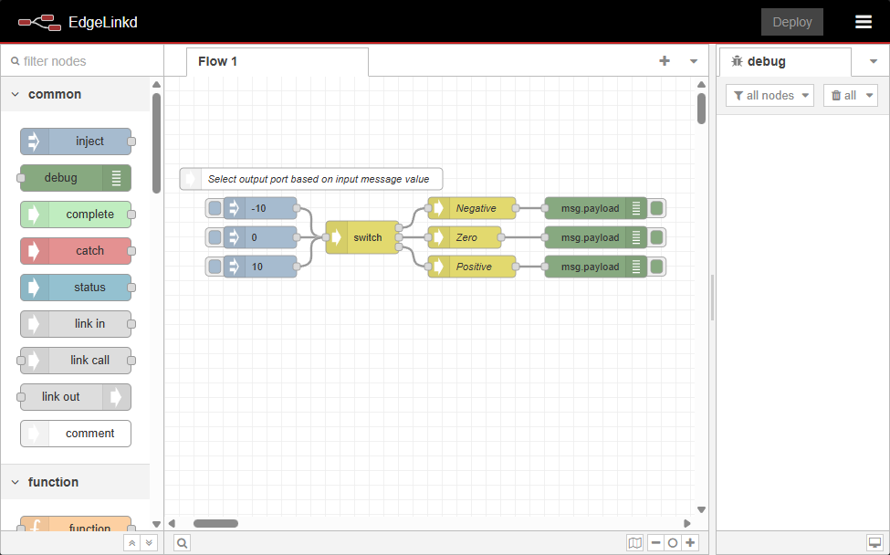
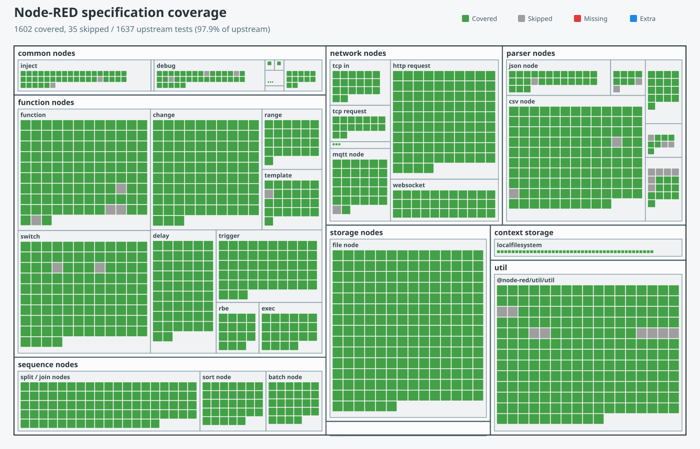

# EdgeLinkd: Node-RED Reimplemented in Rust

[![Build Status]][actions]
[![GitHub Release]][releases]
[![GitHub Downloads]][releases]

[Build Status]: https://img.shields.io/github/actions/workflow/status/oldrev/edgelinkd/CICD.yml?branch=master
[actions]: https://github.com/oldrev/edgelinkd/actions?query=branch%3Amaster
[GitHub Release]: https://img.shields.io/github/v/release/oldrev/edgelinkd?include_prereleases
[releases]: https://github.com/oldrev/edgelinkd/releases
[GitHub Downloads]: https://img.shields.io/github/downloads/oldrev/edgelinkd/total


English | [简中](README.zh-cn.md)

## Overview

**EdgeLinkd** is a high-performance, memory-efficient Node-RED compatible runtime engine built from the ground up in Rust, now featuring an integrated web UI for complete standalone operation.

**Why EdgeLinkd?**
- **10x less memory usage** than Node-RED (only 10% of Node-RED's memory footprint)
- **Native performance** with Rust's zero-cost abstractions
- **Integrated web interface** - full Node-RED UI built-in for flow design and management
- **Standalone operation** - no external Node-RED installation required
- **Drop-in replacement** - use your existing `flows.json` files
- **Perfect for edge devices** with limited resources
- **Node-RED compatibility** - design, deploy, and run flows all in one application

EdgeLinkd now includes the complete Node-RED web editor, allowing you to design flows directly in the browser while executing them with native Rust performance. You can also run it headless for production deployments on resource-constrained devices.

Only the `function` node uses the lightweight QuickJS JS interpreter to run JavaScript code; all other functionalities are implemented in native Rust code for maximum performance.

## A Short Demo


<video src="https://github.com/user-attachments/assets/5841db63-513a-4b36-8566-57c74adb7b60" controls width="100%"></video>

### Use Cases

- **Flow Development**: Design and test flows directly in the integrated web editor
- **Rapid Prototyping**: Full Node-RED UI for quick flow development and iteration
- **IoT Edge Gateways**: Process sensor data with minimal resource usage
- **Industrial Automation**: Run control flows on embedded controllers with web-based monitoring
- **Home Automation**: Deploy smart home logic on Raspberry Pi with remote web access
- **Development & Production**: Use web UI for development, headless mode for production deployment
- **Cloud-to-Edge Migration**: Move Node-RED flows from cloud to edge with unified interface
- **Container Deployments**: Lightweight containers for edge computing with optional web UI
- **Remote Management**: Access and modify flows remotely through the web interface


## Quick Start

### 0. Clone the Repository

**Clone the repository with submodules:**

```bash
git clone --recursive https://github.com/oldrev/edgelinkd.git
```

Or if you've already cloned without submodules:

```bash
git clone https://github.com/oldrev/edgelinkd.git
cd edgelinkd
git submodule update --init --recursive
```

### 1. Build

**Prerequisites**: Rust 1.80 or later

```bash
cargo build --release
```

**Windows users**: Ensure `patch.exe` is in your PATH (included with Git) and install Visual Studio for MSVC.

**Supported platforms**:

- `x86_64-pc-windows-msvc`
- `x86_64-pc-windows-gnu`
- `x86_64-unknown-linux-gnu`
- `aarch64-unknown-linux-gnu`
- `armv7-unknown-linux-gnueabihf`
- `armv7-unknown-linux-gnueabi`

</details>


### 2. Run

**Start EdgeLinkd with integrated web UI (recommended):**

```bash
cargo run --release --
# or after build
./target/release/edgelinkd
```

By default, your browser will open the Node-RED frontend at [http://127.0.0.1:1888](http://127.0.0.1:1888).

**Main command-line options:**

- `[FLOWS_PATH]`: Optional, specify the flow file (default: `~/.edgelinkd/flows.json`)
- `--headless`: Headless mode (no Web UI, suitable for production)
- `--bind <BIND>`: Custom web server bind address (default: `127.0.0.1:1888`)
- `-u, --user-dir <USER_DIR>`: Specify user directory (default: `~/.edgelink`)
- See more options with `--help`

**Examples:**

```bash
# Run in headless mode
./target/release/edgelinkd run --headless

# Specify flow file and port
./target/release/edgelinkd run ./myflows.json --bind 0.0.0.0:8080
```

> All data and configuration are stored in the `~/.edgelink` directory by default.

Use `--help` to see all commands and options:

```bash
./target/release/edgelinkd --help
./target/release/edgelinkd run --help
```

#### Run Unit Tests

```bash
cargo test --all
```

#### Run Integration Tests

Running integration tests requires first installing Python 3.9+ and the corresponding Pytest dependencies:

```bash
pip install -r ./tests/requirements.txt
```

Then execute the following command:

```bash
set PYO3_PYTHON=YOUR_PYTHON_EXECUTABLE_PATH # Windows only
cargo build --all
py.test
```

## Configuration

EdgeLinkd can be configured through command-line arguments and configuration files.

### Web UI Configuration

**Command-line options:**
- `--bind <address>`: Set the web server binding address (default: `127.0.0.1:1888`)
- `--headless`: Run without the web UI for production deployments
- `--user-dir <path>`: Specify custom user directory for flows and settings

**Configuration file:**
You can also configure the web UI through the configuration file (`edgelinkd.toml`):

```toml
[ui-host]
host = "0.0.0.0"
port = 1888
```

## Project Status

The `5.0.9` upgrade branch bundles the Node-RED 5.0.9 editor. Building it requires
Node.js 22.9 or later. The admin API does not grant cross-origin access by default.
The editor supports Monaco (default), Ace, and the basic editor through
`web.editorTheme.codeEditor.lib`; an unknown editor name falls back to `basic`.
Theme schemes are declared through `web.editorTheme.schemes` (`light` and `dark`).
Third-party login and authentication code exchange are outside the current runtime
scope: `POST /auth/token` returns HTTP 501 with `error: "not_supported"`.
File nodes support the built-in UTF-8, UTF-16, binary, hex and base64 encodings. The
`nodes_file_encodings` Cargo feature (enabled in default builds) also enables the
legacy text encodings provided by `encoding_rs`; minimal builds can disable it.
For additional single-byte code pages, enable `file_encodings_legacy` (included in
`full`). Its pure Rust tables are generated from the pinned iconv-lite version,
with the MIT attribution retained. Regenerate using
`node scripts/generate_file_encodings.cjs`; no Node.js library is needed at runtime.
To run the optional encoding oracle tests, build the Python extension with
`cargo build -p edgelink-pymod --features edgelink-core/file_encodings_legacy`, set
`EDGELINK_FILE_ENCODINGS_LEGACY=1`, and run the file-node pytest suites. Use the same
environment variable when generating the spec report for a build with this feature.

**Release 5.0.9**: This branch is based on Node-RED v5.0.9 and includes the integrated editor and Rust runtime.

**New: Integrated Web UI**: EdgeLinkd now includes a complete Node-RED web interface for flow design and management. The web UI is fully compatible with Node-RED's editor and provides the same user experience while running on the high-performance Rust runtime.

**Web UI Features**:
- ✅ Complete Node-RED editor interface
- ✅ Flow design and editing
- ✅ Node palette with all supported nodes  
- ✅ Deploy flows directly from the browser
- ✅ Real-time flow execution monitoring
- ✅ Debug panel integration
- ✅ Settings and configuration management
- ✅ Import/Export flows functionality

The heavy check mark ( :heavy_check_mark: ) below indicates that the supported behavior has passed the ported Node-RED integration tests. A checked node can still have deliberately scoped gaps; use the [live Node-RED spec coverage page](https://oldrev.github.io/edgelinkd/en/specs/) for detailed results.

The [live Node-RED spec coverage page](https://oldrev.github.io/edgelinkd/en/specs/) lets you compare the latest `master` report with published releases and search individual tests.

### Node-RED test status



Regenerate the report and chart with:

```console
python scripts/specs_diff.py 3rd-party/node-red \
  --svg-output tests/REDNODES-SPECS-DIFF.svg
```

## Roadmap

### Static node plug-ins

Default builds include the native Rust `serial in`, `serial out`, `serial request`,
`serial control` and `cbor` plug-ins. Disable `nodes_serialport` or `nodes_cbor`
when selecting features for a minimal build. Editor assets are copied from the
pinned `3rd-party/node-red-nodes` submodule; Node.js is not needed at runtime.

The CBOR plug-in passes all five ported upstream specs and supports a configurable
message property. The Python test bridge preserves binary values with
`{"$__el_type":"Buffer","data":[0,127,255]}`; see the
[Buffer bridge contract](tests/PYTHON-BUFFER-BRIDGE.md) for validation and nested values.
Serial CTS/DSR output control is explicitly unsupported; real-device serial
loopback testing has not been performed on this development host.

Check out our [milestones](https://github.com/oldrev/edgelinkd/milestones) to get a glimpse of the upcoming features and milestones.

## Contribution


We welcome contributions! Whether it's:

- **Bug reports** and feature requests
- **Documentation** improvements
- **Code contributions** and new node implementations
- **Testing** on different platforms

> Note: Please make meaningful contributions, or watch and learn. Simply modifying the README or making non-substantive changes will be considered malicious behavior.

Please read [CONTRIBUTING.md](.github/CONTRIBUTING.md) for details.

### Support the Project

If EdgeLinkd saves you memory and improves your edge deployments, consider supporting development:

<a href='https://ko-fi.com/O5O2U4W4E' target='_blank'></a>

[](https://www.paypal.me/oldrev)

## Known Issues

Please refer to [ISSUES.md](docs/ISSUES.md) for a list of known issues and workarounds.

## Feedback and Support

We welcome your feedback! If you encounter any issues or have suggestions, please open an [issue](https://github.com/edge-link/edgelinkd/issues).

- Website: https://oldrev.github.io/edgelinkd
- Contact me: E-mail: oldrev@gmail.com
- Discord: [https://discord.gg/XJstgANe26](https://discord.gg/XJstgANe26)

## License

This project is licensed under the Apache 2.0 License - see the [LICENSE](LICENSE) file for more details.

Copyright © Li Wei and other contributors. All rights reserved.

This project is a Rust reimplementation of Node-RED
(https://nodered.org/), which is developed by the OpenJS Foundation
and licensed under the Apache License, Version 2.0.

This project includes software developed at The OpenJS Foundation (https://openjsf.org/).

## AI-assisted development disclosure

The engine and runtime kernel were developed by the author. LLM tools assisted with the implementation of peripheral nodes; those changes remain subject to human review and tests.
